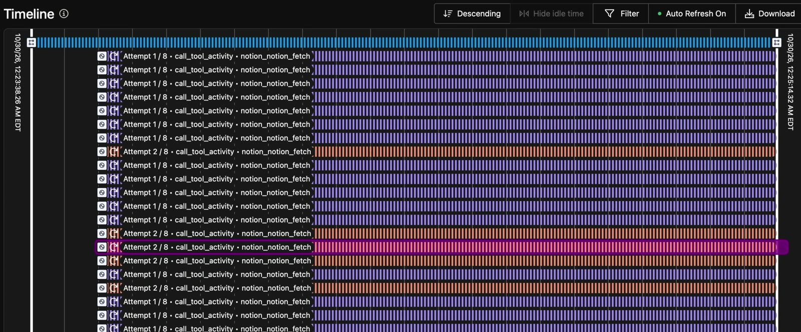
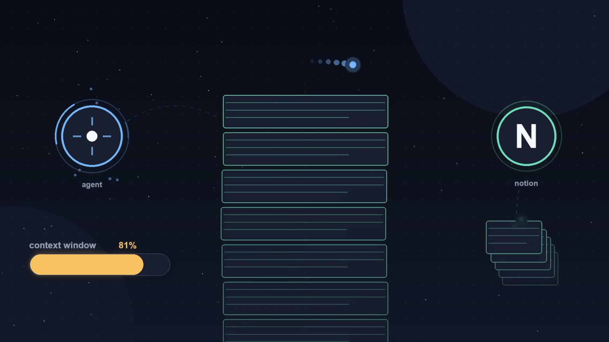
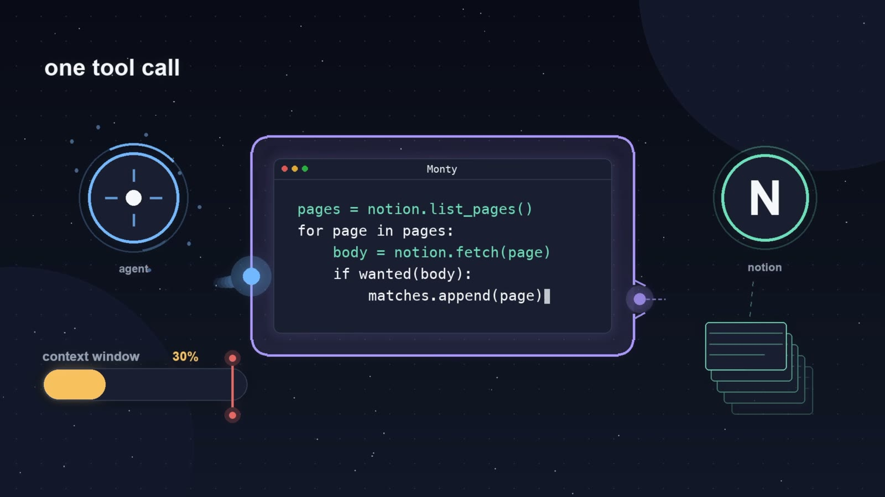
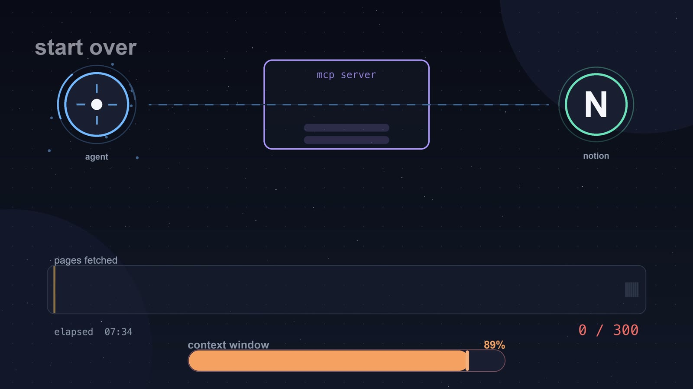
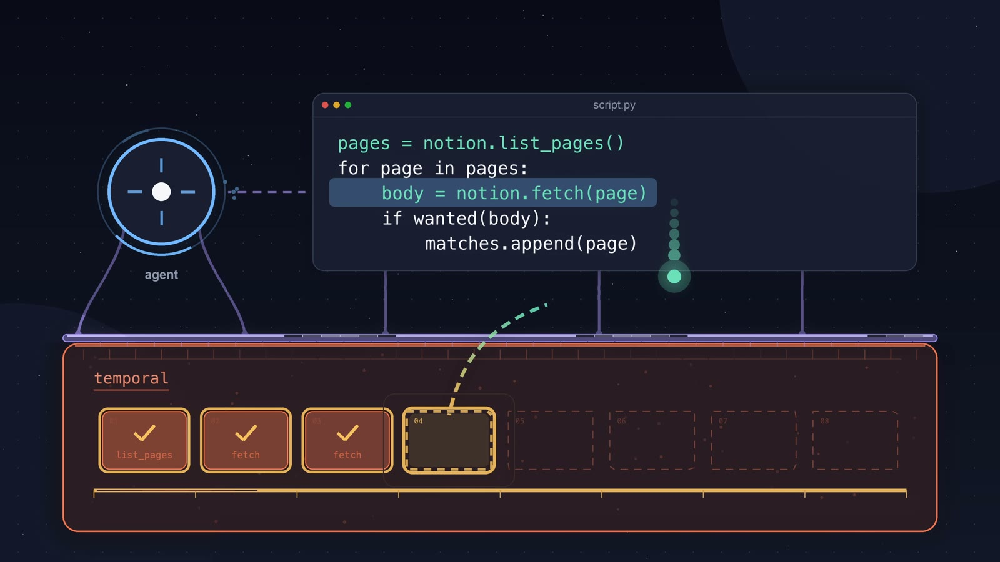

# Durable MCP gateway: code mode on Temporal

When an agent calls MCP tools directly, every result lands in its context window. Ask it which of 30 Notion pages mention AI in their body, and it reads all 30 pages into context to answer a yes-or-no question about each one. A long job of hundreds of tool calls can also die partway through, from a rate limit, a dropped connection, or a restarted MCP server. When that happens, the agent starts over and pays for every call again.

You'll need some terminology to make effective use of this demo:

- **Code mode** keeps tool results out of the agent's context.
  - **MCP** (Model Context Protocol) is how agents such as Claude Code connect to tools. To the agent, this gateway is one MCP server.
  - **Upstream MCP servers** are the servers the gateway sits in front of, such as Notion's. Each of their tools becomes a Python function the agent's script can call.
  - **Code mode** means the agent writes one short Python script that calls those functions, filters the results, and returns only what it needs, instead of calling each tool itself.
  - **Pydantic Monty** is the sandbox the script runs in: a Python interpreter with no imports other than `asyncio`, no network, and no filesystem.
- **Temporal** keeps the script running when something fails.
  - **A Workflow** runs each script. Its Event History records every step, so a restarted Worker continues from the last finished step.
  - **An Activity** runs each tool call. A failed call retries with backoff, up to 8 attempts.
  - **A Worker** is the process that runs Workflows and Activities. Stopping it pauses the script, and starting it again resumes the script.

This repo is a code-mode MCP gateway built on Temporal. The agent gets one tool, `run_script`, and writes a script against the upstream tools. Only the script's result reaches the model, and every tool call is a durable step. When you know how these pieces fit together, you can put the gateway in front of your own MCP servers and give your agents long, many-call jobs without building retry loops into them.



Last verified 2026-11-04: tests pass on macOS (102 passed); the Notion scan wasn't re-run.

## The failure mode

This demo addresses two failures:

- **Tool results flood the context window.** With plain Notion MCP tools, checking 30 pages took the agent's context from about 55K tokens to 142K. With code mode, the same 30 pages took it to 68K, because the page bodies stayed in the script's memory.
- **A long tool-calling run loses its progress.** In real systems, the process running the script dies in a deploy, a laptop sleep, a network drop, or an MCP server restart. Without Temporal, the script's progress lives only in its local memory, so a restart throws away every fetch and the agent runs the script again from the start. The demo's stand-in is stopping the Worker partway through a 300-page scan.





<a id="run"></a>
<a id="tests"></a>

## Run it

You need macOS or Linux (tested on macOS), [uv](https://docs.astral.sh/uv/), Python 3.12 or newer (uv installs it if needed), a Notion account, and an MCP client such as [Claude Code](https://docs.anthropic.com/en/docs/claude-code). The backend downloads the Temporal dev server binary on its first run, so you don't need to start a Temporal server yourself. The Notion run uses your agent's model and your Notion workspace; the tests need neither.

| Step | Command | Success |
| --- | --- | --- |
| Install | `uv sync` | Exit code 0 |
| Test | `uv run pytest tests/ -v` | `102 passed` |
| Add the Notion upstream | `mkdir -p ~/.durable-mcp-gateway && cp examples/upstreams.json ~/.durable-mcp-gateway/` | Exit code 0 |
| Authorize Notion (opens your browser) | `uv run durable-mcp-gateway connect notion` | The browser OAuth flow finishes and the token is stored |
| Check the config (optional) | `uv run durable-mcp-gateway validate` | `✓ notion: N tool(s)` for each upstream, and exit code 0 |
| Start the backend and leave it running | `uv run durable-mcp-gateway backend` | `durable-mcp-gateway backend ready: Temporal at localhost:7677, Web UI http://localhost:8677, worker polling 'durable-mcp-gateway'. Press Ctrl-C to stop.` |
| Register the gateway with Claude Code | `claude mcp add gateway --scope user -- uv --directory $(pwd) run durable-mcp-gateway stdio` | `gateway` appears in `claude mcp list` |

To reset, stop the backend, then delete the gateway's local state:

```bash
rm -rf ~/.durable-mcp-gateway   # reset: exit code 0
```

This deletes the Event History database, the learned tool shapes, the file token store, and `upstreams.json`, so copy the config again before the next run. On macOS, the Notion token stays in Keychain. The repo has no lint command yet.

Authorize Notion before you start the backend. A configured OAuth upstream with no stored token makes the backend stop at startup.

Then restart Claude Code and ask it to scan a Notion database, for example:

> Look at the 100 most recently created pages in the Notion database at https://www.notion.so/your-database-id and give me links for the ones that contain "AI" or "agent" in the body of the page, not just in the title.

The agent calls `list_upstream_tools` to learn the typed functions, then `run_script` with its script. Open the Temporal Web UI at http://localhost:8677 and open the newest `RunScriptWorkflow` to watch each tool call run as an Activity.

To run the example script without an agent, set `DS` at the top of [examples/notion_find_1pagers_mentioning_ai.py](examples/notion_find_1pagers_mentioning_ai.py) to your own database's data source URL, then run:

```bash
uv run durable-mcp-gateway call-tool run_script examples/notion_find_1pagers_mentioning_ai.py
```

<a id="debugging-the-workflow"></a>

<details>
<summary>Run the Temporal server and the Worker as separate processes</summary>

To stop the Worker while Temporal and its Web UI stay up, which is how you watch a script survive a Worker restart, run the backend's two halves in two terminals instead of `backend`:

```bash
uv run durable-mcp-gateway server   # Temporal and the Web UI
uv run durable-mcp-gateway worker   # the Worker alone; Ctrl-C stops just this
```

`worker` exits with the command to start `server` if no server is running. Event History lives in the same SQLite file either way, so a script that was running when the Worker stopped continues once the Worker is back.

</details>

<details>
<summary>Call the gateway's tools from the shell</summary>

`call-tool` runs one of the stdio server's MCP tools by name against the running backend and prints its output. It's a thin wrapper over the same code, so the output matches what the agent sees.

```bash
uv run durable-mcp-gateway call-tool list_upstream_tools           # the typed stub
uv run durable-mcp-gateway call-tool list_upstream_tools_as_json   # the raw JSON catalog
uv run durable-mcp-gateway call-tool run_script path/to/script.py  # run a script in the sandbox
uv run durable-mcp-gateway call-tool run_script -c 'import asyncio; asyncio.run(notion_notion_get_users(page_size=1))'
```

To work on the Workflow alone, without the MCP layer, run a script straight through `RunScriptWorkflow`. This starts the backend if it isn't running:

```bash
uv run python scripts/run_workflow.py 'xs = [i * i for i in range(5)]; print(f"squares: {xs}"); sum(xs)'
```

</details>

## Expected output

These are the lines the gateway prints at each moment, as written in the source.

| Moment | What you see |
| --- | --- |
| Backend starts | `durable-mcp-gateway backend ready: Temporal at localhost:7677, Web UI http://localhost:8677, worker polling 'durable-mcp-gateway'. Press Ctrl-C to stop.` |
| A script runs longer than 10 seconds | `run_script` returns `Script still running after 10s (normal for a long fan-out); it keeps running on the backend.` with a `handle:` and a `live progress:` link to the Web UI. The agent then calls `wait_script_result` with the handle. |
| The Worker stops | `durable-mcp-gateway worker stopped` |
| The Worker starts again | `durable-mcp-gateway worker ready: polling 'durable-mcp-gateway' at localhost:7677. Press Ctrl-C to stop.` |
| The example finishes | `scanning the 100 most recent 1-pagers`, then `matched N of 100` and one line per matching page |

## Same scan, two outcomes

In the video, Maple runs the same 300-page scan twice in code mode and interrupts it partway through each time. In real systems, the interruption is a deploy, a laptop that goes to sleep, or an MCP server restart.

| | Without Temporal (shown in the video only) | With this gateway |
| --- | --- | --- |
| What fails | The code-mode MCP server restarts after a couple hundred fetches. | The Worker stops partway through the fetches. |
| What happens | The script's progress lived in its local memory, so every fetch is lost. The agent gets a connection error and runs the script again from the start. | The Workflow pauses. Finished fetches stay in Event History, and queued fetches wait for a Worker. The agent is still on the same tool call and doesn't notice. |
| After restart | Every page is fetched again, which costs another turn and the time to refetch. | The queued Activities run and the Workflow completes. No finished fetch runs again. |
| Context window at the end | 73K tokens | 72K tokens |

To try it, run `server` and `worker` in separate terminals (see [Run it](#run-it)), ask the agent for a long scan, and open the newest `RunScriptWorkflow` in the Web UI. Partway through, press Ctrl-C in the Worker's terminal to cause the failure, and watch for `durable-mcp-gateway worker stopped`. Then recover by starting it again:

```bash
uv run durable-mcp-gateway worker   # recovery: prints "durable-mcp-gateway worker ready: ..."
```

What to notice in the Web UI: while the Worker is stopped, the queued Activities show `Attempt 1 / 8`, and the calls that were in flight show `Attempt 2 / 8`. Nothing fails.





## Demo takeaways

- Code mode cuts context use because tool results stay in the script's memory. In the video, 30 pages took 142K tokens with plain tools and 68K with code mode.
- Temporal makes the script durable without changing what the agent does. The agent writes the same script; the gateway runs it as a Workflow and each tool call as an Activity.
- Retries, backoff, and concurrency limits live in the gateway, not in each agent's script. One policy covers every agent that uses the gateway.

## What this demo is not

- **Not a production gateway.** It runs one local user against a local Temporal dev server, and stores OAuth tokens in macOS Keychain or a `0600` file.
- **Not the without-Temporal comparison.** The video's non-durable code-mode run used a separate setup that isn't in this repo.
- **Not safe for write tools as is.** A tool call can run more than once: Activities retry up to 8 times, and a call in flight when the Worker stops runs again. That's fine for reads like `notion-fetch`. A tool that writes needs an idempotency key the upstream checks, or should be left out with the upstream's `"skip"` list.
- **Not general Python.** Scripts run in the Monty sandbox, with no imports other than `asyncio`, no network, and no filesystem.

## If the demo won't start

These strings come from the source.

| You see | Cause | Fix |
| --- | --- | --- |
| `Durable backend not reachable at localhost:7677 (...)` | The stdio server can't reach the backend. | Start it with `uv run durable-mcp-gateway backend`, or restart whichever of `server` and `worker` stopped. |
| `these OAuth upstreams are configured but not authorized:` | An OAuth upstream in `upstreams.json` has no stored token. | Run `uv run durable-mcp-gateway connect <server>`, then start the backend. |
| `durable-mcp-gateway worker: no Temporal server at localhost:7677 (...)` | You started `worker` without `server`. | Start `uv run durable-mcp-gateway server` in another terminal first. |

## Cost to run

Measured in the video with Claude Code's context indicator, starting from about 55K tokens at the start of the session:

| Run | Pages | Context window at the end |
| --- | --- | --- |
| Plain Notion MCP tools | 30 | 142K |
| Code mode | 30 | 68K |
| Code mode, MCP server restarted mid-run | 300 | 73K |
| Code mode on Temporal, Worker stopped mid-run | 300 | 72K |

These are context-window sizes, not billed totals. The gateway itself makes no model calls, so the cost is your agent's model, and code mode is what lowers it. Resuming after a Worker restart doesn't re-run finished tool calls. A call that was in flight when the Worker stopped runs again. Starting over without Temporal pays for every call again, plus another agent turn. The tests make no model or Notion calls.

<a id="architecture-two-processes"></a>

## Architecture

![Architecture diagram. The agent calls the stdio MCP server, whose tools are run_script, wait_script_result, check_script_result, and list_upstream_tools. run_script starts a RunScriptWorkflow on the Temporal Service, a dev server on localhost:7677 with its Web UI on port 8677, which stores Event History in a SQLite file. A Worker polls the durable-mcp-gateway Task Queue and runs up to 10 Activities at once. The Workflow steps the script in the Pydantic Monty sandbox with the monty_start and monty_resume Activities, and runs each tool call as a call_tool_activity, which retries up to 8 times and calls the upstream MCP servers, such as Notion's, with the OAuth token from the vault. The Temporal Service and the Worker together are the durable backend.](assets/architecture.svg)

The work is split into two processes so that a script can outlive any single agent session:

- **The durable backend** ([durable_mcp_gateway/serve.py](durable_mcp_gateway/serve.py)) is a Temporal dev server plus the Worker. You leave it running. It keeps Event History in a SQLite file, so a Workflow started in one agent session keeps running and can be checked from another.
- **The stdio server** ([stdio/server.py](stdio/server.py)) is the MCP server the agent talks to. It's only a client of the backend: it starts and checks Workflows and runs no Worker, so it leaves nothing running when the agent exits. If the backend is down, `run_script` returns the command to start it.

How a script runs:

1. `run_script` starts a `RunScriptWorkflow` ([durable_mcp_gateway/workflow.py](durable_mcp_gateway/workflow.py)).
2. The `monty_start` Activity ([durable_mcp_gateway/monty_activities.py](durable_mcp_gateway/monty_activities.py)) type-checks the script against the generated stub of upstream functions and runs it until it awaits tool calls.
3. The Workflow runs each awaited call as a `call_tool_activity` ([durable_mcp_gateway/activities.py](durable_mcp_gateway/activities.py)), concurrently, with up to 10 running at once ([durable_mcp_gateway/worker.py](durable_mcp_gateway/worker.py)).
4. The `monty_resume` Activity feeds the results back into the sandbox, and the loop repeats until the script returns.

The Workflow never runs Monty itself. It passes the sandbox's snapshot between Activities. A tool failure that outlasts its retries comes back to the script as an exception it can catch, rather than failing the Workflow.

<a id="upstream-mcp-tools"></a>

<details>
<summary>Upstream MCP tools and how they're typed</summary>

Upstream MCP servers are configured in `~/.durable-mcp-gateway/upstreams.json`. The backend connects to each at startup, lists its tools, and registers them. Each tool becomes an async Python function named for the namespaced `<server>.<tool>`, made into a valid identifier (`fixture.add` becomes `fixture_add`, and `github-mcp.create-issue` becomes `github_mcp_create_issue`), with one keyword argument per input-schema property. A script calls `await fixture_add(a=1, b=2)`. See [examples/upstreams.json](examples/upstreams.json) for the config shape: `stdio` servers need a `command` (plus optional `args` and `env`), and `streamable-http` servers need a `url` (plus optional static `headers`). `${ENV}` references in any value are expanded from the backend's environment.

A tool that declares an `outputSchema` is typed from it. Many upstream tools declare none, so such a tool is typed from what it has returned. Every successful call contributes the field names and broad types it came back with, never the values. They're merged across calls and cached in `~/.durable-mcp-gateway/upstreams-shapes.json`, so they survive a backend restart. A result keyed by data rather than by fixed fields would store those keys as field names, so a tool whose merged shape passes 64 fields has its shape discarded and isn't learned from again.

That learned shape becomes the function's return type in the stub, a TypedDict of the fields past calls returned. It's incomplete by design, and `run_script` type-checks against it before running, so indexing a field the type doesn't list fails the check even when the script is correct. Use `result.get("field")` to reach a field that hasn't been seen yet; the generated docstring says so. A tool with neither a schema nor an observed result stays untyped. A server's `"skip"` list drops a tool from the catalog.

The catalog lives only in the backend's in-memory registry, and the stdio server fetches it over Temporal. `list_upstream_tools` serves the typed Python stub the agent writes scripts against, and `list_upstream_tools_as_json` serves the raw catalog.

</details>

<a id="upstream-auth"></a>

<details>
<summary>Upstream auth</summary>

An `auth` block on a `streamable-http` upstream selects how it authenticates:

- **Static or bearer:** put credentials in `headers`, such as `"X-API-Key": "${KEY}"`.
- **OAuth:** `"auth": { "type": "oauth" }`. Authorize it once with `uv run durable-mcp-gateway connect <server>`, which runs the browser OAuth flow and stores the token in the vault (macOS Keychain, or a `0600` file elsewhere) per local user and upstream. Discovery and every tool call then use that token and refresh it as needed. A configured OAuth upstream with no stored token makes the backend stop at startup with the connect command to run.

The token reaches tool calls through an opaque session ID: the stdio server passes it to `RunScriptWorkflow`, which passes it to `call_tool_activity`, which resolves it to the user and reads the vault. The sandbox and the Workflow never see the token.

</details>

<a id="environment-overrides"></a>

<details>
<summary>Environment overrides</summary>

- `DURABLE_MCP_GATEWAY_TEMPORAL_ADDRESS` (default `localhost:7677`). This avoids the standard Temporal ports (7233 and 8233), so it doesn't collide with another dev server.
- `DURABLE_MCP_GATEWAY_TEMPORAL_NAMESPACE` (default `default`)
- `DURABLE_MCP_GATEWAY_TEMPORAL_UI_PORT` (default `8677`)
- `DURABLE_MCP_GATEWAY_DB_PATH` (default `~/.durable-mcp-gateway/temporal.db`): where the backend keeps Event History.
- `DURABLE_MCP_GATEWAY_MAX_CONCURRENT_ACTIVITIES` (default `10`): how many tool calls run at once.
- `DURABLE_MCP_GATEWAY_RUN_SCRIPT_WAIT_SECONDS` (default `10`): how long `run_script` waits before returning a handle.

</details>

## Where to go next

### Video

**Temporal & AI Series: MCP Gateway & Code Mode.** Maple Xu, from Temporal's AI Foundations team, scans a 300-page Notion database three ways: with plain MCP tools, with code mode, and with code mode on Temporal, stopping the Worker partway through.

- **What it ran:** Claude Code with the Notion MCP, against a demo database of AI-generated one-pager documents.
- **No Notion account?** The tests run the Workflow against a local test server and a fixture MCP server, with no keys.

### Further reading

- [Temporal for AI](https://docs.temporal.io/ai)
- [Workflows](https://docs.temporal.io/workflows) and [Activities](https://docs.temporal.io/activities)
- [Retry Policies](https://docs.temporal.io/encyclopedia/retry-policies)
- [Workers](https://docs.temporal.io/workers)
- [Temporal developer skill for your coding agent](https://github.com/temporalio/skill-temporal-developer)

## Acknowledgments

Thanks to Brian, Jason, and Melanie for the reviews that shaped this demo and its video, and to Duncan for the call to action.

---

**Ready to try this in your own agent?** [Get started here](https://t.mp/ai-video-cta-mcp).
